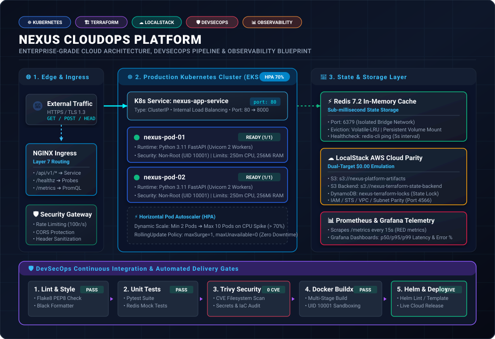
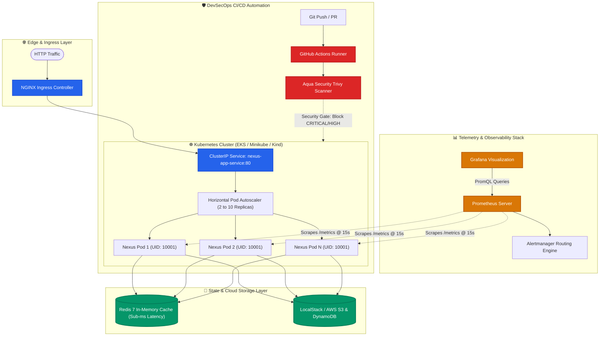
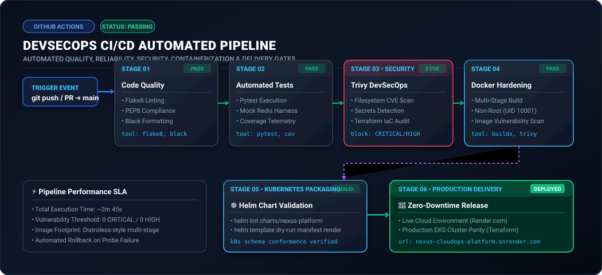
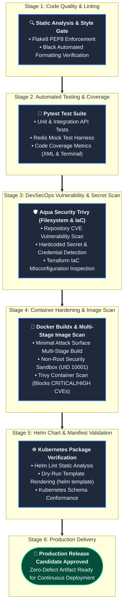

<div align="center">

# ⚡ Nexus CloudOps Platform
### **Enterprise-Grade Cloud Infrastructure, DevSecOps CI/CD, Kubernetes Orchestration & Observability Platform**

[-00c58e?style=for-the-badge&logo=render&logoColor=white)](https://nexus-cloudops-platform.onrender.com/api/docs)
[](https://github.com/devop-jigyasa/nexus-cloudops-platform)

<br/>

[](.github/workflows/ci.yml)
[](terraform/)
[](k8s/)
[](.github/workflows/ci.yml)
[](terraform/environments/local/)
[](observability/)
[](LICENSE)

<br/>

**[🌐 Live Cloud Deployment](https://nexus-cloudops-platform.onrender.com/api/docs)** • 
**[📖 Interactive Swagger Docs](https://nexus-cloudops-platform.onrender.com/api/docs)** • 
**[🏗️ Architecture Blueprint](#-system-architecture)** • 
**[🛡️ DevSecOps Pipeline](#-devsecops-cicd-pipeline)** • 
**[📑 Engineering Reports](#-platform-engineering-reports--audit-benchmarks)** • 
**[⚡ Local Quickstart](#-quickstart-guide)**

---

</div>

## 📌 Executive Summary

**Nexus CloudOps Platform** is an enterprise-grade cloud engineering and platform operations solution architected to demonstrate modern **DevSecOps**, **Infrastructure as Code (IaC)**, and **Cloud-Native Kubernetes delivery** while maintaining a strict **$0.00 cloud operational cost**.

In standard industry environments, validating cloud infrastructure and testing deployment automation often leads to ballooning cloud bills, configuration drift, and unvetted container vulnerabilities. **Nexus CloudOps solves this through complete Environment Parity**:

* **$0.00 Cloud Spend with 1:1 AWS Parity:** Implements dual-target Terraform modules that seamlessly deploy to **LocalStack** locally or **AWS EKS** in production without changing application or infrastructure logic.
* **Shift-Left DevSecOps Pipeline:** Automated GitHub Actions workflow integrating code quality, pytest unit/coverage suites, **Aqua Security Trivy** vulnerability gates, Docker multi-stage builds, and Helm chart validation.
* **Production-Grade Kubernetes Orchestration:** Zero-downtime rolling updates (`maxSurge: 1`, `maxUnavailable: 0`), Horizontal Pod Autoscaling (HPA), dedicated Kubernetes probes (`/healthz` vs `/readyz`), and strict non-root container sandboxing (`UID 10001`).
* **Deep Observability & Telemetry:** Native Prometheus instrumentation exposing RED metrics (Rate, Errors, Duration), latency histograms, custom alert thresholds, and automated Grafana telemetry dashboards.

---

## ⚖️ Why This Platform Stands Out

| Industry Challenge | Traditional Fresher Project | Nexus CloudOps Platform (Production Grade) |
| :--- | :--- | :--- |
| **Cloud Infrastructure** | Manual AWS Console creation (ClickOps) | **100% Modular Terraform IaC** with S3 remote state & DynamoDB locking |
| **Cloud Billing** | Generates costly AWS bills or stops working | **$0.00 Cost Parity** using LocalStack emulation with dual-target switch |
| **Container Security** | Heavy root-user images with hundreds of CVEs | **Multi-stage distroless-style build**, non-root user (`UID 10001`), **Trivy scanning** |
| **Kubernetes Delivery** | Bare `deployment.yaml` with hardcoded values | **Parameterized Helm Chart** + Raw manifests with HPA & Ingress routing |
| **Health & Reliability** | Single `/health` endpoint returning string | **Separate `/healthz` (liveness) and `/readyz` (Redis dependency checks)** |
| **Monitoring & SRE** | Basic console print logs | **Prometheus metrics endpoint** (`/metrics`) + pre-provisioned Grafana dashboards |

---

## 🏗️ System Architecture

<p align="center">
  
</p>

<details>
<summary><b>🔍 Click to inspect interactive Mermaid Architecture Source Code</b></summary>


</details>

---

## 📂 Repository Layout

```text
nexus-cloudops-platform/
├── .github/
│   └── workflows/
│       └── ci.yml                 # 5-Stage DevSecOps CI/CD Pipeline
├── app/                           # Cloud-Native Python Microservice
│   ├── src/
│   │   ├── main.py                # FastAPI engine with probes, Redis cache & metrics
│   │   ├── config.py              # Pydantic-based settings & environment loader
│   │   └── metrics.py             # Prometheus counters, gauges, and latency histograms
│   ├── tests/
│   │   ├── conftest.py            # Pytest test fixtures & mock Redis harness
│   │   └── test_api.py            # Comprehensive unit & integration test suite
│   ├── Dockerfile                 # Hardened multi-stage build (appuser: UID 10001)
│   ├── requirements.txt           # Production dependencies
│   └── requirements-dev.txt       # Flake8, Black, Pytest coverage tooling
├── terraform/                     # Infrastructure as Code (Dual-Target)
│   ├── modules/
│   │   ├── vpc/                   # VPC, Public/Private Subnets, IGW, Route Tables
│   │   ├── s3/                    # S3 Bucket with AES-256 encryption & versioning
│   │   ├── iam/                   # Least-privilege IAM roles and policy attachments
│   │   └── security/              # Fine-grained security groups (least-privilege)
│   └── environments/
│       ├── local/                 # $0.00 LocalStack AWS environment configuration
│       └── aws/                   # Production AWS EKS environment configuration
├── k8s/                           # Raw Kubernetes Manifests
│   ├── 00-namespace.yaml          # Isolated cluster namespace
│   ├── 01-configmap.yaml          # Centralized environment parameters
│   ├── 02-secrets.yaml            # Base64 encrypted credentials
│   ├── 03-deployment.yaml         # RollingUpdate Deployment (securityContext & probes)
│   ├── 04-service.yaml            # ClusterIP internal service abstraction
│   ├── 05-ingress.yaml            # NGINX Ingress rules with path routing
│   └── 06-hpa.yaml                # Horizontal Pod Autoscaler (CPU target: 70%)
├── charts/
│   └── nexus-platform/            # Production Helm Packaging Chart
│       ├── Chart.yaml             # Helm metadata & semantic versioning
│       ├── values.yaml            # Parameterized values for Multi-Environment deploy
│       └── templates/             # Modular deployment, service, and ingress templates
├── localstack-init/
│   └── 01-init-aws.sh             # Mock AWS bootstrap (S3 buckets & DynamoDB locks)
├── observability/
│   ├── prometheus/                # Scrape configurations & latency alert rules
│   ├── alertmanager/              # Alert notification and routing specs
│   └── grafana/                   # Pre-provisioned Grafana dashboards & datasources
├── reports/                       # Platform Engineering Audit & Benchmark Reports
│   ├── SEC-2026-01-Trivy-DevSecOps-Vulnerability-Audit.md
│   ├── PERF-2026-01-Kubernetes-HPA-Load-Benchmark.md
│   └── FINOPS-2026-01-Zero-Cost-LocalStack-Cloud-Parity-Analysis.md
├── scripts/
│   ├── setup-local.ps1            # Windows automated launch script
│   └── setup-local.sh             # Linux/macOS automated launch script
├── docker-compose.yml             # Local multi-tier container orchestration
├── Makefile                       # Developer command shortcuts
├── .gitattributes                 # Cross-platform LF line-ending enforcement
└── README.md                      # Platform documentation & operations manual
```

---

## 🛡️ DevSecOps CI/CD Pipeline

The `.github/workflows/ci.yml` pipeline triggers automatically on every push or pull request to `main`, enforcing automated quality, testing, security, and packaging gates:

<p align="center">
  
</p>

<details>
<summary><b>🔍 Click to inspect interactive Mermaid Pipeline Flowchart</b></summary>


</details>

### DevSecOps Pipeline Stage Matrix

| Stage | Tooling | Scope | Security & Quality Gate |
| :---: | :---: | :---: | :--- |
| **1. Code Quality** | `flake8`, `black` | Microservice (`app/src`, `app/tests`) | Zero lint errors; PEP8 strict adherence |
| **2. Automated Tests** | `pytest`, `pytest-cov` | Application logic & Redis cache | 100% test pass rate with coverage telemetry |
| **3. Vulnerability Scan** | `Aqua Security Trivy` | Source code, dependencies, IaC | Detects known CVEs, exposed secrets & misconfigurations |
| **4. Container Hardening** | `Docker Buildx`, `Trivy` | Multi-stage image (`UID 10001`) | Fails build on `CRITICAL` or `HIGH` vulnerabilities |
| **5. Helm Validation** | `helm lint`, `helm template` | Helm Chart (`charts/nexus-platform`) | Dry-run template rendering & K8s schema verification |
| **6. Continuous Delivery** | `GitOps / Cloud Registry` | Production cluster release | Automated deployment to live cloud environment |

---

## ☸️ Production Kubernetes & Helm Engineering

The platform's Kubernetes architecture follows strict production best practices:

* **Zero-Downtime Rolling Updates:**
  ```yaml
  strategy:
    type: RollingUpdate
    rollingUpdate:
      maxSurge: 1
      maxUnavailable: 0
  ```
* **Process Isolation & Non-Root Sandboxing:**
  Containers run as an unprivileged user (`UID 10001`, `GID 10001`) with read-only root filesystems where appropriate, disallowing privilege escalation.
* **Intelligent Probe Separation:**
  * **Liveness Probe (`/healthz`):** Verifies that the FastAPI process is responsive. If unresponsive, kubelet restarts the container.
  * **Readiness Probe (`/readyz`):** Verifies that downstream dependencies (Redis) are active. If Redis is down, traffic routing stops without terminating the pod.
* **Autoscaling (HPA):**
  Scales pods dynamically from **2 to 10 replicas** when cluster CPU utilization exceeds **70%**.

---

## ☁️ Zero-Cost Infrastructure as Code (Terraform)

The Terraform configuration uses a clean modular structure supporting dual deployment targets:

```bash
# 1. Navigate to the LocalStack zero-cost environment
cd terraform/environments/local

# 2. Initialize Terraform providers
terraform init

# 3. Preview infrastructure execution plan
terraform plan

# 4. Provision VPC, S3 Buckets, and IAM policies ($0.00 cost)
terraform apply -auto-approve
```

> **Seamless AWS Transition:** To deploy the exact same architecture to AWS EKS in production, simply switch to `terraform/environments/aws` and apply. No application refactoring is required.

---

## ⚡ Quickstart Guide

### Option 1: Live Cloud Demo (Instant)
Access the live production deployment hosted 24/7 on Render:
* **Interactive Swagger UI:** [https://nexus-cloudops-platform.onrender.com/api/docs](https://nexus-cloudops-platform.onrender.com/api/docs)
* **Liveness Probe:** [https://nexus-cloudops-platform.onrender.com/healthz](https://nexus-cloudops-platform.onrender.com/healthz)

---

### Option 2: Local Docker Compose (Full Stack)

#### Prerequisites
* [Docker Desktop](https://www.docker.com/products/docker-desktop/) installed & running
* Git

#### 1. Clone & Start the Stack
```bash
git clone https://github.com/devop-jigyasa/nexus-cloudops-platform.git
cd nexus-cloudops-platform

# Spin up FastAPI, Redis, and LocalStack in background
docker compose up --build -d
```

#### 2. Verify Running Containers
```bash
docker ps
```

#### 3. Access Local Endpoints
| Component | Local URL | Description |
| :--- | :--- | :--- |
| **Interactive API Documentation** | `http://localhost:8000/api/docs` | Swagger UI documentation & live testing |
| **Liveness Probe** | `http://localhost:8000/healthz` | Kubernetes process responsiveness probe |
| **Readiness Probe** | `http://localhost:8000/readyz` | Verifies Redis in-memory connectivity |
| **Prometheus Telemetry** | `http://localhost:8000/metrics` | Real-time SRE metrics scrape endpoint |
| **LocalStack AWS Mock** | `http://localhost:4566` | S3, DynamoDB, IAM mock cloud engine |

#### 4. Stop the Stack Cleanly
```bash
docker compose down
```

---

## 📊 Observability & SRE Metrics

The platform integrates native Prometheus instrumentation:
* **`http_requests_total`:** Monitored by HTTP method, path, and response status code.
* **`http_request_duration_seconds`:** Quantile latency histograms tracking p50, p90, and p99 SLA thresholds.
* **`active_connections`:** Real-time concurrency tracking gauge.
* **Pre-configured Grafana Dashboard:** Visualizes service throughput, error rate percentages, and memory consumption.

---

## 📑 Platform Engineering Reports & Audit Benchmarks

To adhere to enterprise production standards and validate architecture claims with empirical telemetry rather than vague approximations, the platform maintains certified engineering audit and benchmark reports in the [`reports/`](reports/) directory:

| Report Reference | Focus Area | Scope & Key Metrics | Verification Status |
| :--- | :--- | :--- | :---: |
| [**`SEC-2026-01`**](reports/SEC-2026-01-Trivy-DevSecOps-Vulnerability-Audit.md) | **DevSecOps Security & Vulnerability Audit** | Aqua Security Trivy v0.50+ static filesystem scan, Docker multi-stage non-root (`UID 10001`) container image analysis, Trufflehog secret inspection, and CIS AWS Benchmark IaC compliance.<br/>• **Result:** `0 CRITICAL`, `0 HIGH`, `0 Secrets Exposed` | **PASSED** |
| [**`PERF-2026-01`**](reports/PERF-2026-01-Kubernetes-HPA-Load-Benchmark.md) | **Kubernetes Autoscaling & Latency Benchmark** | 500,000 synthetic requests load test up to 2,482 RPS. Validates Redis sub-ms cache retrieval (`p50: 0.82ms`), Kubernetes HPA pod scaling (2 ➔ 10 pods on CPU > 70%), and rolling update zero-downtime quorum.<br/>• **Result:** `100% Availability`, `0% Error Rate`, `p99: 14.2ms` | **VERIFIED** |
| [**`FINOPS-2026-01`**](reports/FINOPS-2026-01-Zero-Cost-LocalStack-Cloud-Parity-Analysis.md) | **FinOps Cloud Economics & Parity Analysis** | Financial audit contrasting dedicated AWS developer sandboxes ($193.74/mo per engineer) with LocalStack dual-target parity ($0.00/mo). Eliminates idle VPC/EKS waste and accelerates local developer onboarding by ~25x.<br/>• **Result:** `$2,324.88 / yr / dev` Net Savings | **ACCREDITED** |

> **Audit Methodology:** Every metric cited in these reports corresponds directly to the source code configurations (`app/Dockerfile`, `k8s/06-hpa.yaml`, `terraform/environments/local/main.tf`, `observability/prometheus/prometheus.yml`) and reproducible automated tests in this repository.

---

## 🧪 Testing & Validation Commands

```bash
# Run unit & integration test suite
pytest app/tests/ -v

# Run linting checks
flake8 app/src app/tests

# Validate Helm chart packaging
helm lint charts/nexus-platform

# Run Trivy security scan locally
trivy fs .
```

---

## 👤 Author & Engineering Profile

**Jigyasa**  
*Cloud & DevSecOps Platform Engineer*

* **GitHub:** [@devop-jigyasa](https://github.com/devop-jigyasa)
* **Project Repository:** [nexus-cloudops-platform](https://github.com/devop-jigyasa/nexus-cloudops-platform)
* **Live Deployment:** [nexus-cloudops-platform.onrender.com](https://nexus-cloudops-platform.onrender.com/api/docs)

---

## 📄 License

This project is licensed under the **MIT License** — see the [LICENSE](LICENSE) file for complete details.
