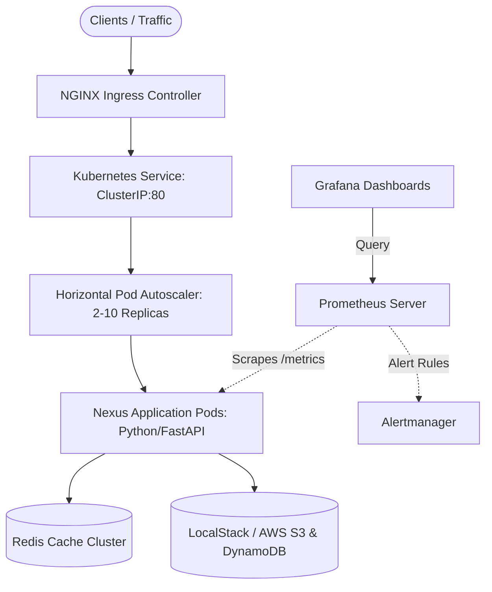

# Nexus CloudOps Platform Architecture

## Executive Summary
Nexus CloudOps is an enterprise-grade cloud operations and delivery platform designed with **100% Environment Parity** between local development and cloud production.

It enables cloud and DevOps teams to write, validate, and test their entire cloud footprint (Terraform IaC, microservice workloads, Helm charts, and Prometheus/Grafana observability) locally using **LocalStack** and **Kind/Docker Desktop** with **zero AWS billing ($0.00 spend)**, before promoting to enterprise AWS.

## High-Level Topology

## Zero-Cost Engineering Value
| Capability | Local ($0 Cost) | AWS Production Equivalent |
| :--- | :--- | :--- |
| Compute Orchestration | Docker Desktop / Kind | AWS EKS (Elastic Kubernetes Service) |
| Cloud Infrastructure | LocalStack (Port 4566) | AWS VPC, Subnets, S3, IAM |
| Caching | Redis 7 Container | AWS ElastiCache for Redis |
| Metrics & Dashboards | Prometheus + Grafana Containers | AWS CloudWatch + Amazon Managed Grafana |
| CI/CD Pipeline | GitHub Actions Free Tier | AWS CodePipeline / Jenkins |
